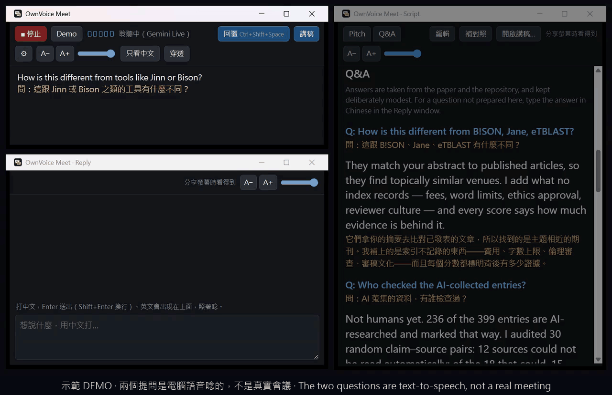
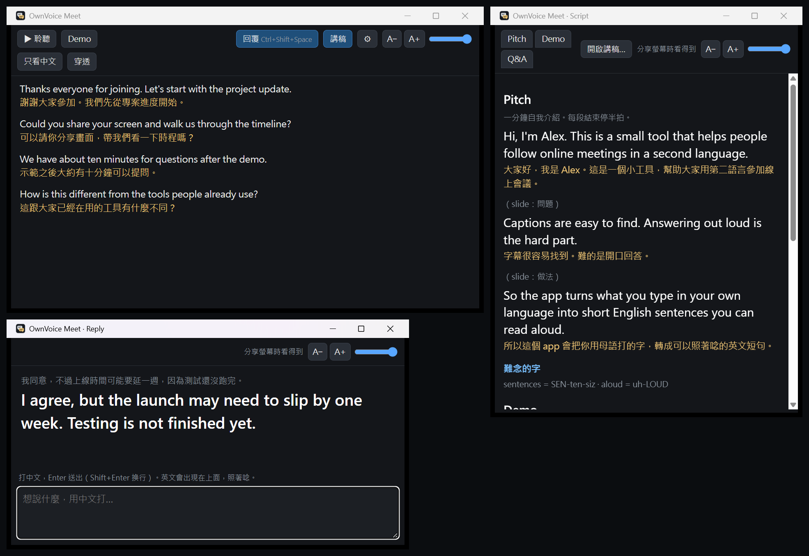
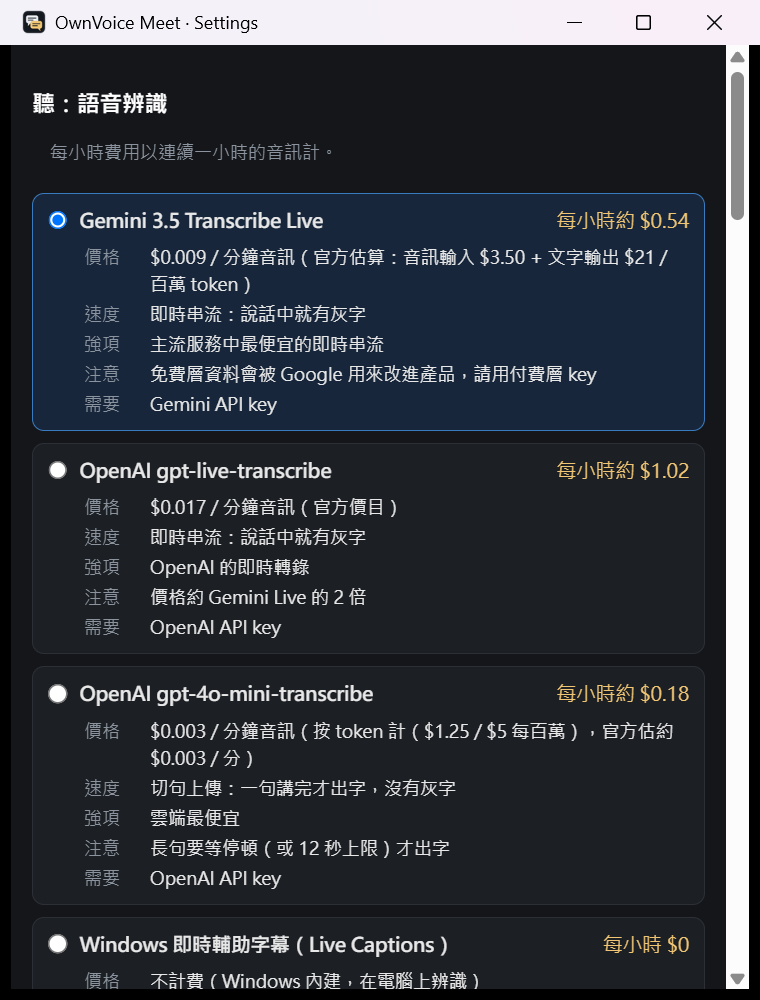

<!-- readme-standard: 2.1.2; type: A; has: autoupdate,userkeys,loopback,binaries; brands: none -->

# OwnVoice Meet

[繁體中文](README.md) · **English**

**Understand the meeting. Answer in your own voice.**

Desktop app for Windows and macOS: live captions and a reply teleprompter for meetings in a second language.
開會時把中文打字變成好唸的英文短句

**[Download for Windows (.exe)](https://github.com/Zaious/ownvoice-meet/releases/latest)** · [Mac (being tested, .dmg)](https://github.com/Zaious/ownvoice-meet/releases/latest) · [Getting started](#getting-started)



*Demo: recorded with the real pipeline; the questions are text-to-speech, and the Script window on the right is darkened. The full recording, not darkened: [MP4](docs/media/demo.mp4) (18 s).*

Gemini Live is listening and Claude Haiku 5.5 translating; speech recognition heard "Jane" as "Jinn". On the right is the script the author used at JCDL 2026 in October 2026, with the numbers of that time. The answer to the first question is in the script; the second was not prepared, so the reply is typed in Chinese.

I read English well, but in a meeting I often can't find the words in time. With OwnVoice Meet you type what you mean in Chinese and get a sentence you can say in English, which you read aloud. It does not answer for you: the words are yours, and so is the voice. While others speak, the captions add the Chinese meaning under each English sentence, and the answers you prepared sit beside them in a bilingual script. The interface is in Traditional Chinese.

> **Status: 0.4.0 · Windows 10 and 11, macOS 11 or later (the Mac version is being tested) · in-app updates on the Mac not yet tried.**

The app is free · your own API keys or ChatGPT plan, or a combination with no key at all · cloud speech recognition about US$0.18–1.02 an hour, translation on the fastest models a few cents (list-price estimates, 2026-10-17; see [Providers and cost](#providers-and-cost))

## What it does

- **What you want to say, as English to read aloud.** Type Chinese in the Reply window and press Enter; the English appears in large type. It draws on what was just said in the meeting and on your script, so names and terms come out right. `Ctrl+Shift+Space` brings it up while Zoom or Teams has focus; put it next to your webcam.
- **The meaning of what others say, as they say it.** The Captions window shows their English live, with the Chinese meaning under each sentence, or the Chinese only. Long sentences are translated while still being spoken (after about 4 seconds, then every 2 seconds), and the full translation replaces that when the sentence ends.
- **Your prepared answers at hand.** The Script & notes window shows your talk, prepared answers and notes in tabs, each line with its meaning, with copy buttons for links and commands. Write it in the window, in English or in Chinese: **補對照** (fill in the other half) adds the missing language. It is saved and comes back next time. See [the JCDL 2026 script](examples/scripts/journal-atlas-jcdl2026.md) for a real one.
- **Who is speaking, at a roundtable.** Each caption line gets a tag, 講者 1, 講者 2 (Speaker 1, 2) and so on; click one to give that speaker a name, and the transcript and summary follow. Voices are told apart on your computer, and no sound is sent anywhere for it (Settings, 收音與存檔, **標出講者**; about 31 MB of models are downloaded the first time).
- **A summary when you fall behind.** **摘要** (Summary) opens a window with the main points so far, brought up to date every few minutes (adjustable, or off). It only sums up what others said: nothing invented, no suggestions of what to say.
- **At a conference venue, too.** Switch the sound source to a microphone and keep the recording and the transcript on your computer, one file per session (press **新段落** (new segment) or `Ctrl+Shift+F9` to move on; names can come from a pasted programme). The recording keeps going when the Wi-Fi drops, and on a bad network you can record without recognition.
- **Not only English.** Captions follow Japanese, Korean, German, French, Spanish, Vietnamese, Thai or Indonesian too, always translated into Chinese (Settings, **別人說的語言**). Replies and **補對照** can be written in the language you speak (Settings, **我說的語言**). English is the default.
- **Your prompts stay off a shared screen.** The Reply and Script windows stay out of screen shares, recordings and screenshots (Windows 10 2004 or later; can be turned off in Settings); the Captions window is not hidden. Each window has its own text size (**A−** / **A+**) and background opacity, and Captions can let clicks pass through to the meeting underneath (`Ctrl+Shift+F8` or the tray icon turns that off).



*Press **Demo** to see what the three windows do: the text is a prepared demo, nothing is recorded and no key is needed.*

New to it? Start with [Getting started](#getting-started).

## What it does not do

It does not answer for you. There are no AI-written replies and no synthetic voice: you decide what to say, and you say it. OwnVoice Meet only turns what you mean into a sentence to read. It does not join the meeting and is not a plug-in for meeting software: it listens to what the computer plays (on the Mac, to a microphone).

## Download

From [the latest release](https://github.com/Zaious/ownvoice-meet/releases/latest):

| | File | Notes |
| --- | --- | --- |
| Windows installer | `OwnVoice.Meet_x.y.z_x64-setup.exe` | Installs for your user only, no administrator rights. Checks for new versions and updates when you press the button (see [Updates](#updates)). |
| Windows portable | `OwnVoice.Meet_x.y.z_x64_portable.zip` | Unzip anywhere and run `OwnVoice Meet.exe`. Never updates itself. |
| macOS (being tested) | `OwnVoice.Meet_x.y.z_universal.dmg` | Intel and Apple silicon, macOS 11 or later. Open the dmg and drag OwnVoice Meet to Applications. Signed and notarised by Apple. Listens through a microphone only, not to what the computer plays. Tried on one Intel Mac. |

On Windows it needs the Microsoft Edge WebView2 Runtime, which Windows 11 includes.

> [!WARNING]
> **"Windows protected your PC"?** OwnVoice Meet is not code-signed, so Windows shows a warning. Click **More info**, then **Run anyway**. For the portable zip you can also right-click `OwnVoice Meet.exe`, open **Properties** and tick **Unblock**.

**Check the file.** The download page shows a SHA-256 next to every file. Compare it with this command (put the version you downloaded in place of `x.y.z`):

```powershell
Get-FileHash .\OwnVoice.Meet_x.y.z_x64-setup.exe -Algorithm SHA256
```

This only shows that the download is not damaged; it cannot catch a download page that was tampered with.

### Getting started

You need Windows 10 or 11 (or macOS 11 or later), and one service for listening and one for translation. Most need an API key of your own; Settings links to each provider's key page. The combination with no key at all is Windows 11 Live Captions for listening and the ChatGPT plan for translation (with ChatGPT Go, Plus, Pro or Business). See [Providers and cost](#providers-and-cost).

To look first, without any setup: open OwnVoice Meet and press **Demo**. The text is a prepared demo; nothing is recorded, nothing goes online, nothing is spent.

1. Press **⚙** in the main window to open Settings, and pick one service for listening (聽) and one for translation (翻).
2. Next to the service you picked, press **取得 key ↗** (get a key), create a key on that site and paste it back. For the ChatGPT plan, press **Continue with ChatGPT** instead and sign in in the browser.
3. Open the meeting, check that the meeting app plays through the default Windows output, and press **▶ 聆聽** (listen) in the main window. The Mac version listens through the microphone.
4. When you want to speak, type what you mean in Chinese in the Reply window and press Enter.

The Captions window now shows the other people's English with the Chinese meaning underneath; after you press Enter, the Reply window shows the English in large type, ready to read aloud. The meeting routine, the script format and money-saving combinations are in [the manual](docs/MANUAL.md) (in Traditional Chinese).

### Updates

Twenty seconds after start, and each time Settings opens, the installed version asks GitHub once whether a newer version is out, and puts a dot on **⚙** if so. Settings, **檢查更新** (check for updates) finds it, and only **更新並重新啟動** (update and restart) downloads and installs it. The portable version never updates itself; checking for updates takes you to the download page. The Mac version can check for updates once it is in Applications, but in-app updating on the Mac has not been tried yet; if it fails, download the dmg again. To stop the automatic check, untick **啟動時自動檢查有沒有新版** (check at start) in Settings: GitHub is then contacted only when you press **檢查更新**. Updates are checked against a signature before they install. This is separate from Windows code signing.

## Providers and cost

Bring your own keys, or your ChatGPT plan; keys are kept in the system's credential store. Pick one option for listening and one for translation:

| Listening | Translation and replies |
|---|---|
| Gemini 3.5 Transcribe Live (live, about US$0.54 an hour) | Claude Haiku 5.5, Sonnet 5.5 |
| OpenAI gpt-live-transcribe (live, about US$1.02 an hour) | OpenAI gpt-6-luna, gpt-6.1-sol |
| OpenAI gpt-4o-mini-transcribe (per sentence, about US$0.18 an hour) | Gemini 3.5 Flash-Lite, 3.8 Flash |
| | **ChatGPT plan** (gpt-6-luna, no API key: press **Continue with ChatGPT** and use your Go, Plus, Pro or Business plan) |
| A Whisper server on your own machine (free) | vLLM or Ollama on your own machine (free) |
| Windows 11 Live Captions (live, free, on the device, no key; experimental, Settings walks you through a one-time setup) | |

The hourly prices in the table are estimates from the providers' list prices, checked on their pricing pages on 2026-10-17; your provider's bill is the authority. Translation on the fastest models costs a few cents an hour (for example Claude Haiku 5.5, about US$0.03 for a busy hour, also estimated from list prices). Settings shows every option with its price, measured speed, strengths, cautions and what it needs, and tracks estimated usage. The ChatGPT plan is an OpenAI feature in preview; it can translate but not recognise speech. Money-saving combinations are in [section 6 of the manual](docs/MANUAL.md#6-省錢) (in Traditional Chinese).



Running everything locally is a matter of URLs in Settings: see [docs/LOCAL.md](docs/LOCAL.md). The Apple on-device options (macOS 26) listed in Settings are greyed out and cannot be chosen.

## Troubleshooting

| Problem | What to do |
| --- | --- |
| "Windows protected your PC" | See [Download](#download). |
| OwnVoice Meet does not start | Usually the Microsoft Edge WebView2 Runtime is missing: Windows 11 includes it; on Windows 10, install it from Microsoft. |
| No captions, and the level meter does not move | The meeting app must play through the default Windows output; after switching to headphones, press **■ 停止** (stop) and then **▶ 聆聽** (listen). |
| Captions appear but no Chinese | Read the error on the Chinese line: usually the translation key is missing, the quota is used up, or the account cannot use that model. |
| Captions switch to another language | In Settings, set **別人說的語言** (the language others speak) to the right one instead of automatic detection. |

More in [section 9 of the manual](docs/MANUAL.md#9-常見問題) (in Traditional Chinese). Still stuck? See [Contributing and getting help](#contributing-and-getting-help).

## Documentation

- [Manual](docs/MANUAL.md) (in Traditional Chinese): installing, a meeting from start to end, the script, saving money, running locally, common questions
- [Changelog](CHANGELOG.md) (in Traditional Chinese; release notes on GitHub are in both languages): what changed in each version
- [Architecture](docs/ARCHITECTURE.md): how the parts work together, and which tests are run by hand
- [Running against your own servers](docs/LOCAL.md)
- [Website](https://ownvoice.chroniclecore.com/)

## Privacy

OwnVoice Meet runs on your computer. There is no OwnVoice Meet account, and the app has no analytics. It connects only to:

- **The speech service you choose**: Google's Gemini API (`generativelanguage.googleapis.com`) or OpenAI (`api.openai.com`), after you press **▶ 聆聽**, with the meeting audio. A local server means only the URL you entered; Windows Live Captions or record-only keeps the audio on the computer.
- **The translation service you choose**: Anthropic (`api.anthropic.com`), OpenAI (`api.openai.com`), Google (`generativelanguage.googleapis.com`), or the local server you entered. It gets the caption text, the replies you type and your script (so names and terms come out right); the summary uses the same service.
- **The ChatGPT plan**: signing in opens `auth.openai.com` in your browser, and the result comes back to the app through a temporary port on `127.0.0.1`; translations then go to `api.openai.com`.
- **Speaker models**: the first time **標出講者** (speaker labels) is ticked, two model files are downloaded from sherpa-onnx's releases on GitHub (`github.com` and the download addresses it redirects to) and checked against their digests before use; after that, speakers are worked out on the computer.
- **GitHub**: twenty seconds after start and when Settings opens, `api.github.com` is asked whether a newer version is out; **檢查更新** and **更新並重新啟動** fetch the update information and files from GitHub (`github.com` and the download addresses it redirects to). The automatic check can be turned off in Settings (see [Updates](#updates)).

The key links (**取得 key ↗**) and the sponsor link in Settings open in your browser only when you press them.

It all runs under your own accounts. Some meetings are confidential, and some places require everyone's consent before a conversation is transcribed: check before you turn it on. On the Gemini API's unpaid tier, Google uses the content you submit and the responses to provide, improve and develop its products and machine-learning technologies, and people may review it; on the paid tier it does not use them to improve its products ([Gemini API Additional Terms of Service](https://ai.google.dev/gemini-api/terms), version effective 2026-03-23, checked 2026-11-24). For a confidential meeting, use a paid-tier key.

Keys are kept in the system's credential store (Windows Credential Manager, the macOS Keychain) and never written to a file; so is the ChatGPT sign-in. With saving on, recordings, transcripts and summaries stay on your computer; saving is off by default.

**Deleting what it keeps.** Quit OwnVoice Meet first:

1. Keys and the ChatGPT sign-in: Settings, **清除所有 key（也登出 ChatGPT）** (clear all keys, and sign out of ChatGPT). You can also disconnect Sign in with ChatGPT in ChatGPT's settings.
2. Settings, the script and the usage record: on Windows in `%APPDATA%\io.github.zaious.ownvoice-meet\`, on the Mac in `~/Library/Application Support/io.github.zaious.ownvoice-meet/`. The script is `script.md` in that folder; copy it first if you want to keep it.
3. The web view's cache: on Windows in `%LOCALAPPDATA%\io.github.zaious.ownvoice-meet\`.
4. Recordings, transcripts and summaries (if saving was on): by default in the `OwnVoice Meet` folder in Documents, or the saving folder you chose in Settings; **開啟存檔資料夾** (open the saving folder) in Settings opens it.
5. The app itself: uninstall the installed version from Windows Settings, Apps; for the portable version, delete the unzipped folder.

On Windows, these five steps remove everything, with one exception: if you used Windows Live Captions, OwnVoice Meet may have switched its recognition language to the meeting's language. That is a setting of Live Captions itself and stays as it is. Where the Mac version keeps its web view cache, I have not checked yet.

## How it started

I'm Zaious, an independent researcher from Taiwan (ChronicleCore Studio 編年史記工作室). I read English well, but in a meeting I often can't find the words in time. On 16 October 2026 I had an online demo at JCDL 2026, the ACM/IEEE Joint Conference on Digital Libraries: a one-minute pitch, then questions in breakout rooms. That afternoon I built a first version in about two hours (Python, Whisper on my own GPU, Claude Haiku 5.5) and kept it open through the whole 1.5-hour session: captions with the Chinese meaning while others spoke, my bilingual script and prepared answers beside them, and the reply box for anything I had not prepared.

Translation for that evening, a session of an hour and a half and a bit, cost **US$0.11** on Claude Haiku 5.5, according to the Claude Console: 5,570,065 input tokens and 28,585 output tokens. Most of the input is the prepared script, which goes with every request so names and terms come out right; it is read from the prompt cache, which is why it costs so little. Speech recognition ran on my own GPU, so it cost nothing.

Many people asked for the tool afterwards. OwnVoice Meet is that tool rebuilt to be shared: speech recognition in the cloud or on the device, so you do not need a GPU, and your choice of providers. The public part of that evening's script (the pitch and the prepared answers) is in [examples/scripts/journal-atlas-jcdl2026.md](examples/scripts/journal-atlas-jcdl2026.md).

## How this was made

I decide what OwnVoice Meet does and what it claims, and I answer for every release. AI agents wrote most of the code and the documentation: of the 49 commits up to 0.4.0, 46 carry an AI co-author trailer (`Co-Authored-By`) that you can see in the git history; the other 3 are merge commits. On every push, CI runs the type check, the front-end tests and the Rust tests, and builds the app on clean Windows and macOS machines (see [ci.yml](.github/workflows/ci.yml)); tests that need real services or speakers do not run in CI, and [docs/ARCHITECTURE.md](docs/ARCHITECTURE.md) lists them.

The translations, the English for your replies and the summaries in the app are written on the spot by the language model you choose, and no person checks them sentence by sentence. Look before you read one aloud.

## Build from source

Requirements: Node.js 24 (the version CI uses) and Rust 1.80 or later (the `rust-version` in `Cargo.toml`). On Windows you also need the Microsoft C++ build tools and the WebView2 Runtime (included in Windows 11); on macOS, the Xcode Command Line Tools.

Install the dependencies from the lockfile and start in development mode (changes reload as you go):

```bash
npm ci
npm run tauri dev
```

Press **Demo** to see captions without audio or keys. For development, copy `env.example` to `.env.local` (git-ignored) and fill in keys; debug builds read it.

Build the release app without an installer, as CI does; on Windows this gives `src-tauri/target/release/ownvoice-meet.exe`:

```bash
npm run tauri build -- --no-bundle
```

CI runs these checks on every push (see [ci.yml](.github/workflows/ci.yml)):

```bash
npm run typecheck
npm test
```

The Rust tests run in `src-tauri`:

```bash
cd src-tauri
cargo test --lib
```

## Contributing and getting help

Stuck, or found a mistake? Look at [the common questions in the manual](docs/MANUAL.md#9-常見問題) (in Traditional Chinese) first; if that does not help, open an [issue](https://github.com/Zaious/ownvoice-meet/issues). Opening an issue needs a free GitHub account. Issues and pull requests are welcome in Chinese or English.

Pull requests are accepted. For a larger change, open an issue first to say what you want to change; a pull request needs to pass the checks in [Build from source](#build-from-source). What is welcome, what is not, and how to note AI-assisted work: see [CONTRIBUTING.md](CONTRIBUTING.md).

## Acknowledgements

Reading Windows Live Captions, cutting its text into sentences and translating long sentences early follow [LiveCaptions-Translator](https://github.com/SakiRinn/LiveCaptions-Translator) by SakiRinn and contributors (Apache-2.0): its code was read and the logic rewritten in Rust; [THIRD_PARTY_NOTICES.md](THIRD_PARTY_NOTICES.md) lists what changed.

## Sponsor

OwnVoice Meet is free: no ads and no paid features. If it is useful to you, you can sponsor it at [portaly.cc/chroniclecore](https://portaly.cc/chroniclecore); inside the app, only **♥ 贊助作者** (sponsor the author) under Settings, **關於** (About) links to the same page. It unlocks nothing, and every feature is the same for everyone.

## Licence

[Apache License 2.0](LICENSE) (`Apache-2.0`); see also [NOTICE](NOTICE). © 2026 ChronicleCore Studio 編年史記工作室. This licence covers the code and the original text in this repository, including the screenshots, the demo GIF and video, and the example script. The names of Gemini, Claude, OpenAI, ChatGPT and other services are not part of it. A work based on OwnVoice Meet must keep the attribution notices in NOTICE (section 4(d)). Section 6 of the licence does not grant permission to use the name "OwnVoice Meet", except for describing where the work comes from and reproducing the NOTICE.

---

Made by [Zaious](https://zaious.dev/) at [ChronicleCore Studio](https://studio.chroniclecore.com) 編年史記工作室.
