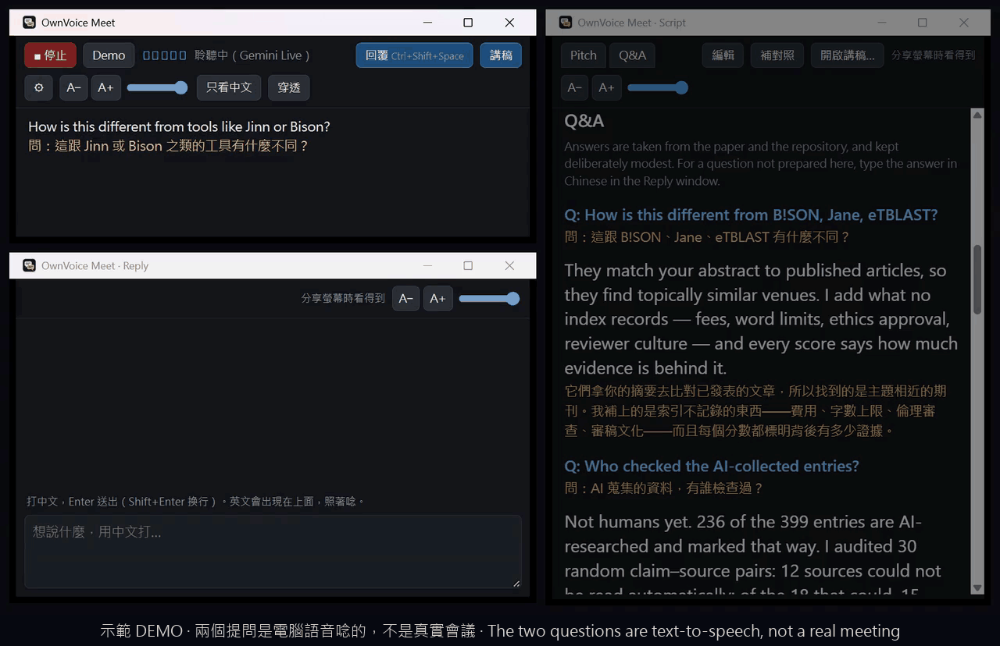
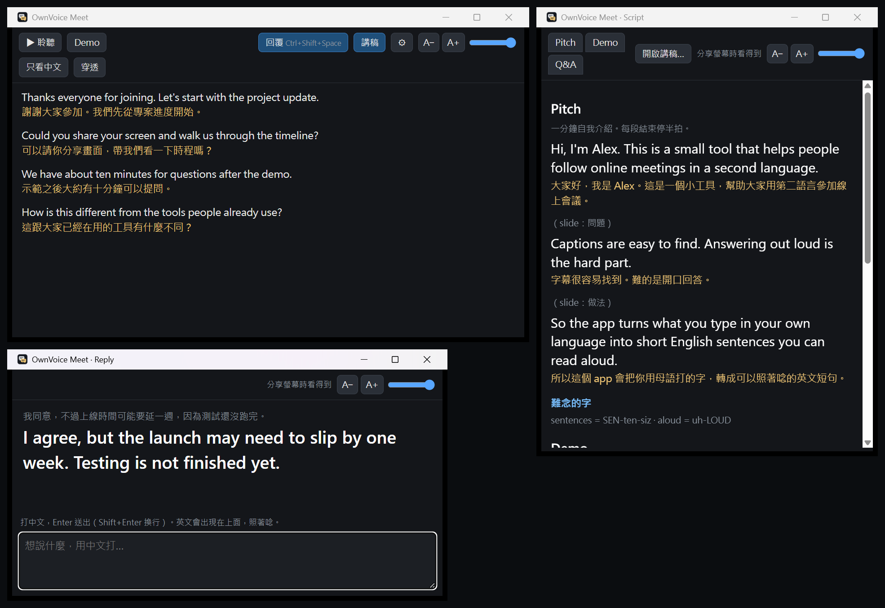
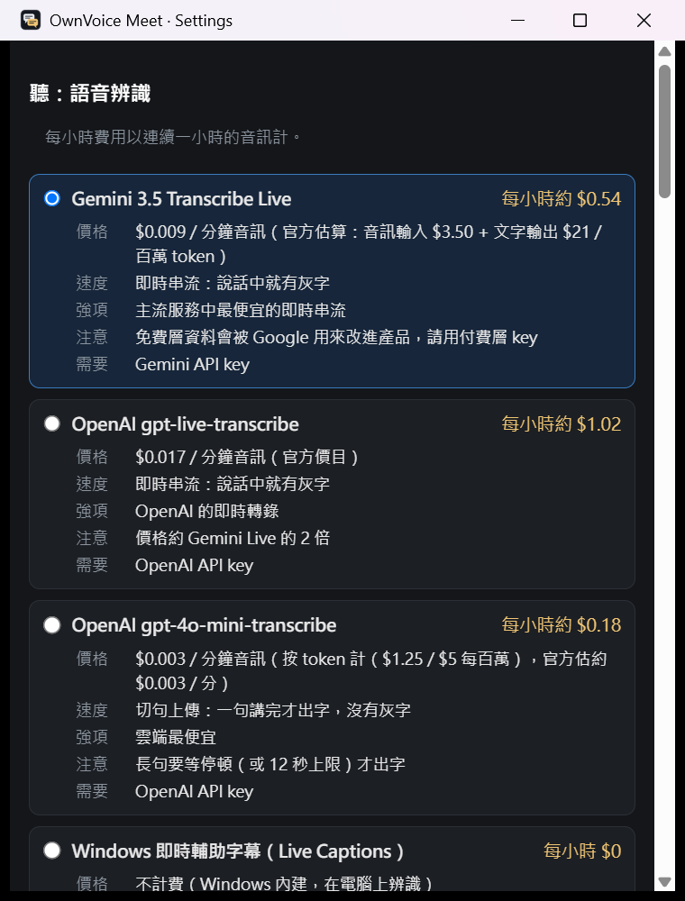

<!-- readme-standard: 2.1.2; type: A; has: autoupdate,userkeys,loopback,binaries; brands: none -->

# OwnVoice Meet

**繁體中文** · [English](README.en.md)

**聽得懂會議，用自己的聲音回答。**

Desktop app for Windows and macOS: live captions and a reply teleprompter for meetings in a second language.
開會時把中文打字變成好唸的英文短句

**[下載 Windows 版（.exe）](https://github.com/Zaious/ownvoice-meet/releases/latest)** · [Mac 版（測試中，.dmg）](https://github.com/Zaious/ownvoice-meet/releases/latest) · [開始使用](#開始使用)



*示範：真實流程錄製，提問是電腦語音唸的，右側講稿視窗已調暗。完整、未調暗的錄影見 [MP4 版](docs/media/demo.mp4)（18 秒）。*

Gemini Live 聽、Claude Haiku 5.5 翻；語音辨識把 Jane 聽成了 Jinn。右側是作者 2026-10 在 JCDL 2026 用的講稿，數字是當時的。第一個問題的答案在講稿裡；第二個問題作者沒有準備，就用中文打回覆。

我英文看得懂，但開會時常常一下子想不出該怎麼說。用 OwnVoice Meet，你用中文打出想說的意思，它給你一句說得出口的英文，你照著唸。它不替你作答：話是你自己的，聲音也是你自己的。別人說的英文，字幕會即時接上中文意思；事先準備好的回答，就放在旁邊的中英對照講稿裡。

> **狀態：0.5.0 · Windows 10、11 與 macOS 11 以上（Mac 版測試中） · Mac 版的程式內更新還沒實測過。**

程式免費 · 用你自己的 API key 或 ChatGPT 方案，也可以全部在電腦上跑，不用 key、不花錢 · 雲端語音辨識每小時約 0.18～1.02 美元，翻譯選最快一級約幾美分（牌價估算，2026-10-17；見「[服務與費用](#服務與費用)」）

## 它做什麼

- **想說的話，變成照著唸的英文。** 在回覆視窗用中文打、按 Enter，大字英文就出現。它參考剛剛的會議內容和你的講稿，名字和術語會用對。回覆和講稿的 **補對照** 也可以改成你要說的其他語言（設定 → **我說的語言**，預設英文）。在 Zoom、Teams 裡按 `Ctrl+Shift+Space` 就叫得出來；建議放在攝影機旁邊。
- **別人說什麼，馬上看到中文意思。** 字幕視窗即時顯示對方說的話，每句下面接著中文；也可以只看中文。不只英文，日文、韓文、德文、法文、西班牙文、越南文、泰文、印尼文也聽得懂（設定 → **別人說的語言**）。長句講到一半就先翻（約 4 秒後，之後每 2 秒更新），講完再換成完整翻譯。
- **準備好的回答就在手邊。** 講稿與備忘視窗分頁顯示你的簡報稿、準備好的回答和備忘，每行附中文意思，連結和指令可以一鍵複製。直接在視窗裡寫，英文或中文都行：**補對照** 會補上另一半。會自動保存，下次打開還在。真實範例見 [JCDL 2026 講稿](examples/scripts/journal-atlas-jcdl2026.md)。
- **跟不上時看摘要。** 按 **摘要** 打開一個視窗，列出到目前為止的重點，每幾分鐘自動更新（可調，或關掉）。它只整理別人說過的話，不編造，也不建議你說什麼。
- **研討會會場、圓桌論壇也能用。** 收音改成麥克風，錄音和逐字稿存在你的電腦，每個場次一個檔（按 **新段落** 或 `Ctrl+Shift+F9` 切換，名稱可以先貼議程）；網路斷了錄音照樣繼續，網路太差可以只錄音、不辨識。勾選 **標出講者**（設定 → 收音與存檔），每句字幕前面會標「講者 1、講者 2…」，點一下就能改成名字，逐字稿和摘要跟著改；聲紋在你的電腦上比對，聲音不會為此送出去，第一次會下載約 31 MB 的模型。
- **辨識可以完全在你的電腦上跑。** 「聽」選 **本機辨識**：免費、聲音不送出去、不需要 key；英文用 NVIDIA Parakeet，中文、日文、韓文用 SenseVoice，中英夾雜的場合每句自己判斷語言。第一次要下載約 910 MB 的模型，沒有灰字（每句講完約 0.5–1 秒出字）。「翻」也可以選 **本機翻譯**（Qwen3 1.7B，下載約 1.1 GB）：兩個都選本機，就完全不用網路、不花錢、不需要任何 key；翻譯品質不如雲端模型，意思大多對、偶爾用詞不準。本機辨識、本機翻譯與標出講者都只在 Windows 上實際跑過，Mac 版還沒試。
- **分享螢幕時，提詞不會被看到。** 回覆與講稿視窗不會出現在分享畫面、錄影和截圖裡（Windows 10 2004 以上；設定裡可以關）；字幕視窗不隱藏。每個視窗有自己的字級（**A−**／**A+**）和背景透明度；字幕可以讓滑鼠點擊穿過去，操作下面的會議（按 `Ctrl+Shift+F8` 或系統匣圖示恢復）。



*按 **Demo** 就能看到三個視窗在做什麼：畫面是預先寫好的示範文字，不收音、不需要 key。*

第一次用？先看「[開始使用](#開始使用)」。

## 它不做什麼

它不會替你作答：沒有 AI 代寫的回答，也沒有合成語音。說什麼由你決定，也由你自己說出口；OwnVoice Meet 只把你的意思變成要唸的句子。它也不會加入會議，不是會議軟體的外掛：它聽的是電腦播放的聲音（Mac 版是麥克風）。

## 下載

到[最新版下載頁](https://github.com/Zaious/ownvoice-meet/releases/latest)：

| | 檔案 | 說明 |
| --- | --- | --- |
| Windows 安裝版 | `OwnVoice.Meet_x.y.z_x64-setup.exe` | 只裝給目前使用者，不需要系統管理員權限。會檢查新版，按下才更新（見「[更新](#更新)」）。 |
| Windows 免安裝版 | `OwnVoice.Meet_x.y.z_x64_portable.zip` | 解壓縮到任何地方，執行 `OwnVoice Meet.exe`。不會自己更新。 |
| macOS（測試中） | `OwnVoice.Meet_x.y.z_universal.dmg` | Intel 和 Apple 晶片都能用，macOS 11 以上。打開 dmg，把 OwnVoice Meet 拖到「應用程式」。有 Apple 簽章並經過 Apple 公證。只能收麥克風，收不到電腦播放的聲音。我在一台 Intel Mac 上試過。 |

Windows 版需要 Microsoft Edge WebView2 Runtime（Windows 11 內建）。

> [!WARNING]
> **出現「Windows 已保護您的電腦」？** OwnVoice Meet 沒有程式碼簽章，所以 Windows 會跳出警告。按 **其他資訊**，再按 **仍要執行**。免安裝版也可以在 `OwnVoice Meet.exe` 按右鍵，開 **內容**，勾選 **解除封鎖**。

**核對檔案。** 下載頁的每個檔案旁邊都有 SHA-256，可以用這個指令比對（把 `x.y.z` 換成你下載的版本）：

```powershell
Get-FileHash .\OwnVoice.Meet_x.y.z_x64-setup.exe -Algorithm SHA256
```

這只能確認下載沒有損毀，擋不住下載頁本身被竄改。

### 開始使用

你需要 Windows 10 或 11（或 macOS 11 以上），以及「聽」和「翻」各一個服務：多數服務要你自己的 API key（設定裡有每家申請 key 的連結）。完全不用 key 的組合有兩種：本機辨識（聽）加本機翻譯（翻），全部在電腦上跑，不用帳號也不花錢，第一次要下載約 2 GB 的模型；或 Windows 11 即時輔助字幕（聽）加 ChatGPT 方案（翻，要有 ChatGPT Go、Plus、Pro 或 Business）。選法見「[服務與費用](#服務與費用)」。

想先看看、不必設定：打開 OwnVoice Meet，按 **Demo**。畫面是預先寫好的示範文字，不收音、不連網、不花錢。

1. 按主視窗的 **⚙** 打開設定，在「聽」和「翻」各選一個服務。
2. 在選到的服務旁按 **取得 key ↗**，到該網站建立 key，貼回來。選 ChatGPT 方案時，改按 **Continue with ChatGPT**，在瀏覽器登入。
3. 打開會議，確認會議軟體的喇叭是 Windows 的預設輸出，按主視窗的 **▶ 聆聽**。Mac 版收的是麥克風。
4. 想發言時，在回覆視窗用中文打想說的話，按 Enter。

這時字幕視窗會出現對方的英文，下面接著中文意思；你按 Enter 之後，回覆視窗出現大字英文，照著唸就好。開會流程、講稿格式、省錢組合見[使用手冊](docs/MANUAL.md)。

### 更新

安裝版在啟動 20 秒後，以及每次打開設定時，會問 GitHub 一次有沒有新版；有的話 **⚙** 會出現小點。設定 → **檢查更新** 會找到新版，按 **更新並重新啟動** 才會下載並安裝。免安裝版不會自己更新，檢查更新會帶你到下載頁。Mac 版放進「應用程式」之後也能檢查更新，但 Mac 的程式內更新還沒實測過；更新失敗就重新下載 dmg。不想讓它自己去問，在設定裡取消勾選 **啟動時自動檢查有沒有新版**：之後只有你按 **檢查更新** 時才會連到 GitHub。更新檔安裝前會先驗證簽章；這跟 Windows 的程式碼簽章是兩回事。

## 服務與費用

用你自己的 key，或你的 ChatGPT 方案；key 存在系統的認證管理員。聽和翻各選一個：

| 聽（語音辨識） | 翻（翻譯與回覆） |
|---|---|
| Gemini 3.5 Transcribe Live（即時，約每小時 0.54 美元） | Claude Haiku 5.5、Sonnet 5.5 |
| OpenAI gpt-live-transcribe（即時，約每小時 1.02 美元） | OpenAI gpt-6-luna、gpt-6.1-sol |
| OpenAI gpt-4o-mini-transcribe（一句講完才出字，約每小時 0.18 美元） | Gemini 3.5 Flash-Lite、3.8 Flash |
| | **ChatGPT 方案**（gpt-6-luna，不用 API key：按 **Continue with ChatGPT** 登入，用你的 Go／Plus／Pro／Business 方案額度） |
| 本機辨識（Parakeet＋SenseVoice；免費、在電腦上辨識、不需要 key；第一次下載約 910 MB） | 本機翻譯（Qwen3 1.7B；免費、在電腦上翻譯、不需要 key；第一次下載約 1.1 GB；品質不如雲端） |
| 自己電腦上的 Whisper 伺服器（免費） | 自己電腦上的 vLLM 或 Ollama（免費） |
| Windows 11 即時輔助字幕（即時、免費、在電腦上辨識、不需要 key；實驗功能，設定會帶你完成一次性設定） | |

表中的每小時價格是依各家官方牌價估算的，2026-10-17 查自各家的價目頁；實際以各家帳單為準。翻譯選最快一級時，每小時約幾美分（例如 Claude Haiku 5.5，忙碌的一小時約 0.03 美元，同樣是牌價估算）。設定裡每個選項都列出價格、實測速度、強項、注意事項與需要什麼，也會記錄估算用量。ChatGPT 方案是 OpenAI 預覽中的功能，只能翻譯，不能辨識語音。省錢組合見[使用手冊第 6 節](docs/MANUAL.md#6-省錢)。



全部在自己電腦上跑，只要在設定裡填網址：見 [docs/LOCAL.md](docs/LOCAL.md)（英文）。設定裡列出的 Apple 裝置上的選項（macOS 26）是灰的，不能選。

## 疑難排解

| 狀況 | 怎麼辦 |
| --- | --- |
| 出現「Windows 已保護您的電腦」 | 見「[下載](#下載)」。 |
| OwnVoice Meet 打不開 | 通常是少了 Microsoft Edge WebView2 Runtime：Windows 11 內建，Windows 10 請到微軟官網安裝。 |
| 沒有字幕、音量條不動 | 會議軟體的喇叭要是 Windows 的預設輸出；換了耳機，要先按 **■ 停止** 再按 **▶ 聆聽**。 |
| 有字幕，中文卻沒出來 | 看中文那一行的錯誤訊息：多半是翻譯的 key 沒填、額度不足，或帳號沒開那個模型。 |
| 字幕跳成別的語言 | 設定 → **別人說的語言** 選對的語言，不要用「自動偵測」。 |

其他狀況見[使用手冊第 9 節](docs/MANUAL.md#9-常見問題)。還是卡住？請看「[貢獻與尋求協助](#貢獻與尋求協助)」。

## 說明文件

- [使用手冊](docs/MANUAL.md)：安裝、開會流程、講稿、省錢組合、本機執行、常見問題
- [變更紀錄](CHANGELOG.md)：每一版改了什麼
- [架構](docs/ARCHITECTURE.md)（英文）：程式怎麼分工、哪些測試要手動跑
- [在自己的伺服器上執行](docs/LOCAL.md)（英文）
- [產品網站](https://ownvoice.chroniclecore.com/)

## 隱私

OwnVoice Meet 在你的電腦上執行，不需要註冊 OwnVoice Meet 的帳號，程式裡也沒有使用分析（analytics）。它只連到：

- **你選的語音辨識服務**：Google 的 Gemini API（`generativelanguage.googleapis.com`）或 OpenAI（`api.openai.com`），在你按 **▶ 聆聽** 之後，送出會議的聲音。選本機伺服器時，只連你填的網址；選 Windows 即時輔助字幕或只錄音時，聲音不出電腦。
- **你選的翻譯服務**：Anthropic（`api.anthropic.com`）、OpenAI（`api.openai.com`）、Google（`generativelanguage.googleapis.com`），或你填的本機伺服器。送出字幕文字、你打的回覆，以及你的講稿（名字和術語才會用對）；摘要也走同一個服務。
- **ChatGPT 方案**：登入時用瀏覽器開 `auth.openai.com`，登入結果經本機 `127.0.0.1` 的暫時連接埠交回程式；之後的翻譯送到 `api.openai.com`。
- **本機翻譯模型**：在設定按「下載本機翻譯模型」時，從 Hugging Face 下載一個模型檔（約 1.1 GB），核對無誤才使用；之後翻譯都在電腦上算，文字不送出去。
- **本機辨識模型**：在設定按「下載本機辨識模型」時，從 Hugging Face（`huggingface.co`，以及它轉向的下載網址）下載六個模型檔，核對無誤才使用；之後辨識都在電腦上算，聲音不送出去。
- **講者模型**：第一次勾選「標出講者」時，從 GitHub 上 sherpa-onnx 的發布頁（`github.com`，以及它轉向的下載網址）下載兩個模型檔，核對無誤才使用；之後標講者都在電腦上算。
- **GitHub**：啟動 20 秒後與打開設定時，問 `api.github.com` 有沒有新版；按 **檢查更新**、**更新並重新啟動** 時，從 GitHub 取得更新資訊與檔案（`github.com`，以及它轉向的下載網址）。自動檢查可以在設定裡關掉（見「[更新](#更新)」）。

設定裡的 **取得 key ↗** 和贊助連結，是你按了才用瀏覽器打開。

用的是你自己的帳號：有些會議有保密要求，有些地方轉錄談話需要所有人同意，開始前請先確認。Gemini API 的免費層，Google 會用你送出的內容和產生的回應來提供、改進、開發它的產品與機器學習技術，也可能由人工審閱；付費層不會拿來改進產品（[Gemini API 附加服務條款](https://ai.google.dev/gemini-api/terms)，2026-03-23 生效版，2026-11-24 查核）。會議有保密要求時，請用付費層的 key。

key 存在系統的認證管理員（Windows 認證管理員、Mac 鑰匙圈），不會寫進檔案；ChatGPT 登入的憑證也一樣。開啟存檔時，錄音、逐字稿與摘要只存在你的電腦，預設不存。

**刪除存下的資料。** 先結束 OwnVoice Meet：

1. key 與 ChatGPT 登入：設定 → **清除所有 key（也登出 ChatGPT）**。也可以到 ChatGPT 的設定中斷 Sign in with ChatGPT 的連線。
2. 設定、講稿與用量紀錄：Windows 在 `%APPDATA%\io.github.zaious.ownvoice-meet\`，Mac 在 `~/Library/Application Support/io.github.zaious.ownvoice-meet/`。講稿是其中的 `script.md`，想備份就先複製它。
3. 網頁元件的快取：Windows 在 `%LOCALAPPDATA%\io.github.zaious.ownvoice-meet\`。
4. 錄音、逐字稿與摘要（有開存檔時）：預設在「文件」裡的 `OwnVoice Meet` 資料夾，或你在設定裡指定的存檔資料夾；設定裡的 **開啟存檔資料夾** 可以直接打開。
5. 程式本身：安裝版從 Windows 的「設定 → 應用程式」解除安裝；免安裝版刪掉解壓縮出來的資料夾。

在 Windows 上做完這五步，就清乾淨了。只有一個例外：用過 Windows 即時輔助字幕時，OwnVoice Meet 可能把它的辨識語言切成會議的語言；那是 Windows 即時輔助字幕自己的設定，不會跟著還原。Mac 版網頁元件的快取放在哪裡，我還沒核對過。

## 起源

我是 Zaious，來自台灣的獨立研究者（ChronicleCore Studio 編年史記工作室），英文看得懂，但開會時常常一下子想不出該怎麼說。2026 年 10 月 16 日，我要在 JCDL 2026（ACM/IEEE 數位圖書館聯合會議）的線上 Demo 場發表：一分鐘簡報，接著在 breakout room 回答提問。當天下午我花大約兩小時做出第一版（Python、自己 GPU 上的 Whisper、Claude Haiku 5.5），開著它撐完 1.5 小時的場次：別人說話時看字幕和中文意思，旁邊是中英對照的講稿和準備好的回答，沒準備到的就用回覆框。

那一晚一個半多小時的場次，翻譯費用是 **0.11 美元**（Claude Haiku 5.5，Claude Console 數字）：輸入 5,570,065 個 token、輸出 28,585 個。輸入大多是講稿：每次請求都會帶著它，名字和術語才會對；它從提示快取讀取，所以幾乎不花錢。語音辨識跑在自己的 GPU 上，不用錢。

之後很多人來要這個工具。OwnVoice Meet 就是為了分享而重做的版本：語音辨識可以走雲端或在電腦上跑，不需要 GPU，服務也由你挑。那天晚上講稿的公開部分（簡報和準備好的回答）在 [examples/scripts/journal-atlas-jcdl2026.md](examples/scripts/journal-atlas-jcdl2026.md)。

## 這是怎麼做的

OwnVoice Meet 做什麼、主張什麼由我決定，每次發布由我負責。程式與文件大部分由 AI agent 撰寫：到 0.5.0 為止的 67 個 commit 中，64 個帶有 AI 共同作者標記（`Co-Authored-By`），在 git 歷史裡查得到；另外 3 個是合併 commit。CI 每次 push 都會跑型別檢查、前端測試與 Rust 測試，並在乾淨的 Windows 與 macOS 機器上建置（見 [ci.yml](.github/workflows/ci.yml)）；需要真實服務或喇叭的測試不在 CI 裡跑，清單在 [docs/ARCHITECTURE.md](docs/ARCHITECTURE.md)。

程式裡的翻譯、回覆的英文和摘要，是你選的語言模型當場產生的，沒有人逐句查過。照著唸之前，請自己看一眼。

## 從原始碼建置

需要 Node.js 24（CI 用的版本）、Rust 1.80 或更新版本（`Cargo.toml` 的 `rust-version`）。Windows 上另需 Microsoft C++ 建置工具與 WebView2 Runtime（Windows 11 內建）；macOS 上另需 Xcode Command Line Tools。

從 lockfile 安裝相依套件，並以開發模式啟動（改了程式會自動重新載入）：

```bash
npm ci
npm run tauri dev
```

按 **Demo** 可以在沒有音訊和 key 的情況下看字幕。開發時把 `env.example` 複製成 `.env.local`（不會進 git）並填入 key，debug 版會讀它。

建置正式版的程式，不打包安裝檔（CI 也這樣建）；在 Windows 上會得到 `src-tauri/target/release/ownvoice-meet.exe`：

```bash
npm run tauri build -- --no-bundle
```

CI 每次 push 都會跑這些檢查（見 [ci.yml](.github/workflows/ci.yml)）：

```bash
npm run typecheck
npm test
```

Rust 的測試在 `src-tauri` 裡跑：

```bash
cd src-tauri
cargo test --lib
```

## 貢獻與尋求協助

卡住了，或發現錯誤？先看[使用手冊的常見問題](docs/MANUAL.md#9-常見問題)；還是不行，請開 [issue](https://github.com/Zaious/ownvoice-meet/issues)。開 issue 需要一個免費的 GitHub 帳號。Issue 與 PR 用中文或英文都可以。

收 PR。改動比較大時，請先開 issue 說明想改什麼；PR 要通過「[從原始碼建置](#從原始碼建置)」裡的檢查。收什麼、不收什麼，以及 AI 輔助的貢獻怎麼寫，見 [CONTRIBUTING.md](CONTRIBUTING.md)。

## 致謝

Windows 即時輔助字幕的讀取、斷句與長句先翻的做法，移植自 SakiRinn 與貢獻者的 [LiveCaptions-Translator](https://github.com/SakiRinn/LiveCaptions-Translator)（Apache-2.0）：讀過它的程式碼後用 Rust 重寫，改了哪些見 [THIRD_PARTY_NOTICES.md](THIRD_PARTY_NOTICES.md)。

## 贊助

OwnVoice Meet 免費：沒有廣告，也沒有付費功能。如果它對你有用，可以到 [portaly.cc/chroniclecore](https://portaly.cc/chroniclecore) 贊助；程式裡只有設定 → **關於** 的 **♥ 贊助作者** 連到同一個頁面。贊助不會解鎖任何功能，每個人用到的功能都一樣。

## 授權

[Apache License 2.0](LICENSE)（`Apache-2.0`），另見 [NOTICE](NOTICE)。著作權人：ChronicleCore Studio 編年史記工作室（2026）。本授權涵蓋這個 repo 裡的程式碼與原創文字，也包括截圖、示範動圖與影片和範例講稿；Gemini、Claude、OpenAI、ChatGPT 等服務的名稱不在其中。以 OwnVoice Meet 為基礎的作品須保留 NOTICE 中的署名聲明（第 4(d) 條）。授權第 6 條不授予使用「OwnVoice Meet」這個名稱的許可，說明作品來源與轉載 NOTICE 時除外。

---

Made by [Zaious](https://zaious.dev/) at [ChronicleCore Studio](https://studio.chroniclecore.com) 編年史記工作室.
