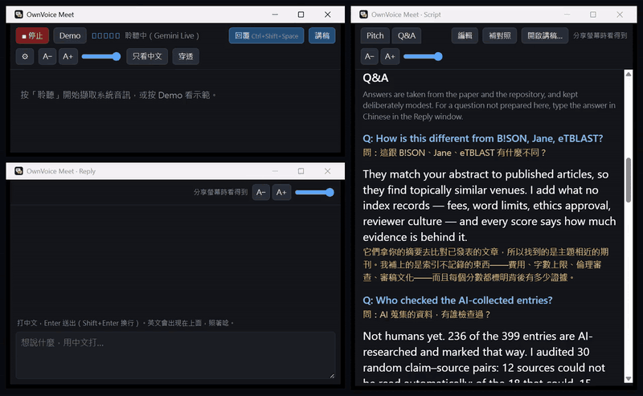
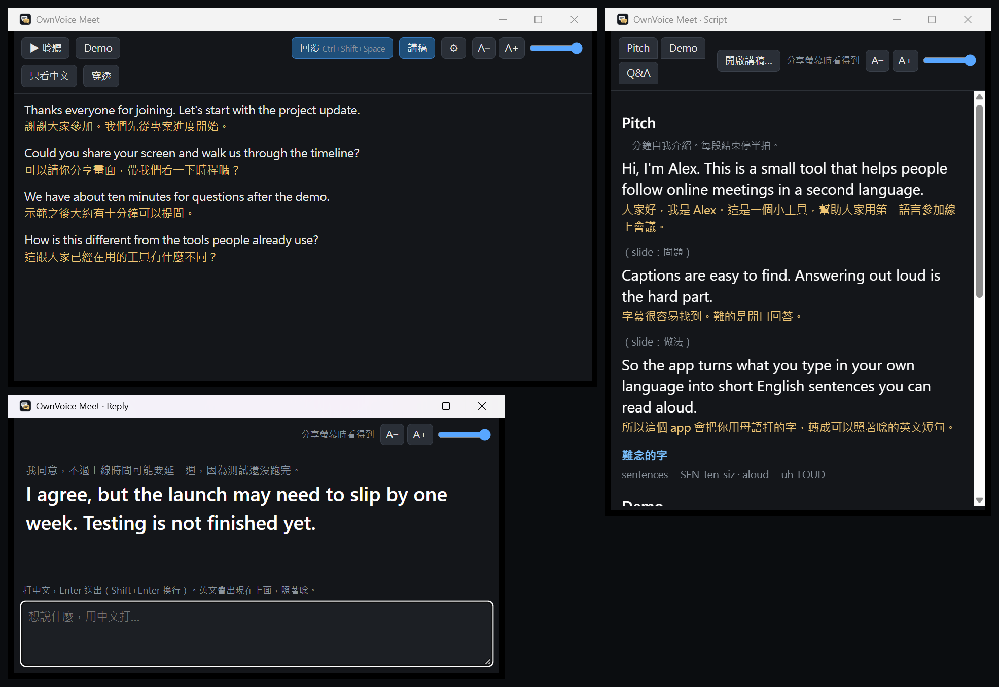
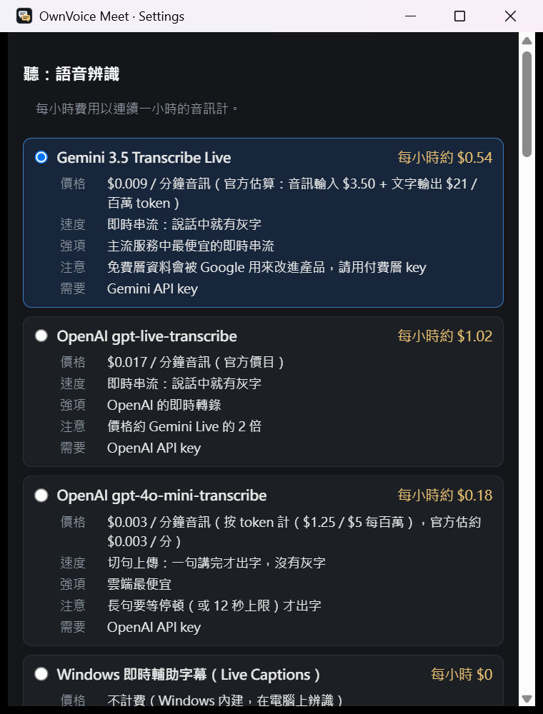

# OwnVoice Meet

**Understand the meeting. Answer in your own voice.**

For people who join meetings, talks and Q&A in English but read it better than they speak it. Type what you mean in your own language; OwnVoice Meet turns it into short, natural English that you read aloud. The words are yours, and so is the voice.

> Status: 0.1.1, Windows. Working with real services. See [docs/ARCHITECTURE.md](docs/ARCHITECTURE.md).



*Recorded with the real pipeline (Gemini Live listening, Claude Haiku 5.5 translating) and the author's JCDL 2026 script: one question has a prepared answer on the right; for the other, a reply typed in Chinese becomes English to read aloud. The questions are text-to-speech. [MP4 version](docs/media/demo.mp4).*

**使用手冊（中文）：[docs/MANUAL.md](docs/MANUAL.md)**, from installing to saving money and running everything locally.

## What it does

Three windows; use the ones you need and put each where it helps.

| Window | What you get |
|---|---|
| **Reply** | Type in Chinese, press Enter, read the English aloud in large type. It knows what was just said in the meeting and what is in your script, so it uses the right names and terms. `Ctrl+Shift+Space` brings it up while Zoom or Teams has focus. Put it next to your webcam. |
| **Captions** | What others say, in English as they speak, with the meaning in Chinese under each sentence. |
| **Script & notes** | Your talk, prepared answers and notes, each line with its meaning, in tabs, with copy buttons for links and commands. Write it in the window (a template and a format guide are built in), in English or in Chinese: **補對照** fills in the other half, the Chinese meaning of an English line or the English to read for a Chinese one. It is saved and comes back next time. See [the JCDL 2026 script](examples/scripts/journal-atlas-jcdl2026.md) for a real one. |

Each window has its own text size (A− / A+) and background opacity, remembered between runs. Captions can show the translation only, and can let clicks pass through to the meeting underneath (turn it off with `Ctrl+Shift+F8` or the tray icon). When you share your screen, the Reply and Script windows stay off the share, recordings and screenshots (Windows 10 2004 or later; can be turned off in Settings). The Captions window is not hidden.

## What it does not do

It does not answer for you. There are no AI-written replies and no synthetic voice: you decide what to say, and you say it. OwnVoice Meet helps with the English.

## How it started

I'm an independent researcher from Taiwan, and I read English much better than I speak it. On 16 October 2026 I had an online demo at JCDL 2026, the ACM/IEEE Joint Conference on Digital Libraries: a one-minute pitch, then questions in breakout rooms. That afternoon I built a first version in about two hours (Python, Whisper on my own GPU, Claude Haiku 5.5) and kept it open through the whole 1.5-hour session: captions with the Chinese meaning while others spoke, my bilingual script and prepared answers beside them, and the reply box for anything I had not prepared.

Translation for that whole day cost **US$0.11** on Claude Haiku 5.5, according to the Claude Console: 5,570,065 input tokens and 28,585 output tokens, including the testing while I built it. Most of the input is the prepared script, which goes with every request so names and terms come out right; it is read from the prompt cache, which is why it costs so little. Speech recognition ran on my own GPU, so it cost nothing.

Many people asked for the tool afterwards. OwnVoice Meet is that tool rebuilt to be shared: speech recognition in the cloud or on the device, so you do not need a GPU, and your choice of providers. The public part of that evening's script (the pitch and the prepared answers) is in [examples/scripts/journal-atlas-jcdl2026.md](examples/scripts/journal-atlas-jcdl2026.md).



*Press **Demo** to see all three windows without audio or keys.*

## Providers and cost

Bring your own keys; Settings links to each provider's key page, and keys are kept in the system keychain. Pick one option for listening and one for translation:

| Listening | Translation and replies |
|---|---|
| Gemini 3.5 Transcribe Live (live, about $0.54/hour) | Claude Haiku 5.5, Sonnet 5.5 |
| OpenAI gpt-live-transcribe (live, about $1.02/hour) | OpenAI gpt-6-luna, gpt-6.1-sol |
| OpenAI gpt-4o-mini-transcribe (per sentence, about $0.18/hour) | Gemini 3.5 Flash-Lite, 3.8 Flash |
| A Whisper server on your own machine (free) | vLLM or Ollama on your own machine (free) |
| Windows 11 Live Captions (live, free, on the device, no key; experimental, Settings walks you through a one-time setup) | |

Long sentences are translated while they are still being spoken (after about 4 seconds, then every 2 seconds), so you are not left waiting for the speaker to pause; the final translation replaces it when the sentence ends.

Translation costs a few cents an hour on the fastest models (for example Claude Haiku 5.5, about $0.03 for a busy hour). Settings shows every option with its price and measured speed, and tracks estimated usage. Prices are list prices; your provider's bill is the authority.



Each option in Settings shows its price, measured speed, strengths, cautions and what it needs, with a link to the provider's key page.

Running everything locally is a matter of URLs in Settings: see [docs/LOCAL.md](docs/LOCAL.md). Apple on-device options (macOS 26) are planned.

## Privacy

Meeting audio goes to the speech service you choose, and text to the language model you choose, under your own account. Some meetings are confidential, and some places require everyone's consent before a conversation is transcribed: check before you turn it on. Use paid-tier keys where the provider uses free-tier data for training (Gemini does). Local servers keep everything on your machine, and so does Windows Live Captions for listening.

## Download

Windows 10 and 11, from [Releases](https://github.com/Zaious/ownvoice-meet/releases):

- **Installer** (`OwnVoice.Meet_<version>_x64-setup.exe`): installs for your user only, no administrator rights. Settings > Check for updates finds a newer version, and Update installs it after checking its signature.
- **Portable** (`OwnVoice.Meet_<version>_x64_portable.zip`): unzip anywhere and run `OwnVoice Meet.exe`. It never updates itself; Check for updates links to the download page.

The builds are not code-signed yet, so Windows may say "Windows protected your PC": choose **More info**, then **Run anyway**. Both need the Microsoft Edge WebView2 Runtime, which Windows 11 includes. OwnVoice Meet contacts GitHub only when you press Check for updates.

## Building from source

Requirements: Node.js 20+, Rust (stable), and on Windows the WebView2 runtime (included in Windows 11).

```
npm install
npx tauri dev
```

Press **Demo** to see captions without audio or keys. For development, copy `env.example` to `.env.local` (git-ignored) and fill in keys; debug builds read it.

Checks: `npm test`, `npm run typecheck`, and `cargo test --lib` in `src-tauri`; CI runs them on every push. Tests that call real services or need speakers are marked ignored; [docs/ARCHITECTURE.md](docs/ARCHITECTURE.md) lists them.

## 中文說明

**聽得懂會議，用自己的聲音回答。**

給英文「看得懂、說不太出口」的人：想說什麼就用中文打，OwnVoice Meet 把它變成好唸的口語英文短句，你照著唸。話是你自己的，聲音也是你自己的。旁邊有對方發言的英文字幕和中文意思，還能開一份中英對照的講稿與 Q&A 備忘。

它不會替你作答：沒有 AI 代寫的回答，也沒有合成語音。

**完整使用手冊：[docs/MANUAL.md](docs/MANUAL.md)**（安裝、開會流程、講稿、省錢組合、本機執行、常見問題）。

**起源：** 作者是來自台灣的獨立研究者，英文看得懂、說不太出口。2026 年 10 月 16 日要在 JCDL 2026（ACM/IEEE 數位圖書館聯合會議）的線上 Demo 場發表，有一分鐘簡報和 breakout room 問答。當天下午花大約兩小時做出第一版，開著它撐完 1.5 小時的場次。那一整天 Claude Haiku 5.5 的翻譯費用是 **0.11 美元**（Claude Console 數字，含開發測試），語音辨識跑在自己的 GPU 上，不用錢。之後很多人來要這個工具，OwnVoice Meet 就是為了分享而重做的版本。

**支持作者：** 如果它幫上你，歡迎到 [portaly.cc/chroniclecore](https://portaly.cc/chroniclecore) 贊助。

下載（Windows 10、11）：到 [Releases](https://github.com/Zaious/ownvoice-meet/releases) 選安裝版（`…_x64-setup.exe`，只裝給目前使用者、不需系統管理員權限，可以在設定裡「檢查更新」後自動更新）或免安裝版（`…_x64_portable.zip`，解壓縮就能用，不會自己更新）。程式還沒有數位簽章，Windows 若顯示「Windows 已保護您的電腦」，按「其他資訊」再按「仍要執行」。

## Support

If OwnVoice Meet helps you, you can support the author at [portaly.cc/chroniclecore](https://portaly.cc/chroniclecore) (also linked from Settings > 關於).

## License

Apache License 2.0. See [LICENSE](LICENSE) and [NOTICE](NOTICE); logic ported from other projects is credited in [THIRD_PARTY_NOTICES.md](THIRD_PARTY_NOTICES.md). A work based on OwnVoice Meet must carry the NOTICE; the name "OwnVoice Meet" is not licensed for other works.
